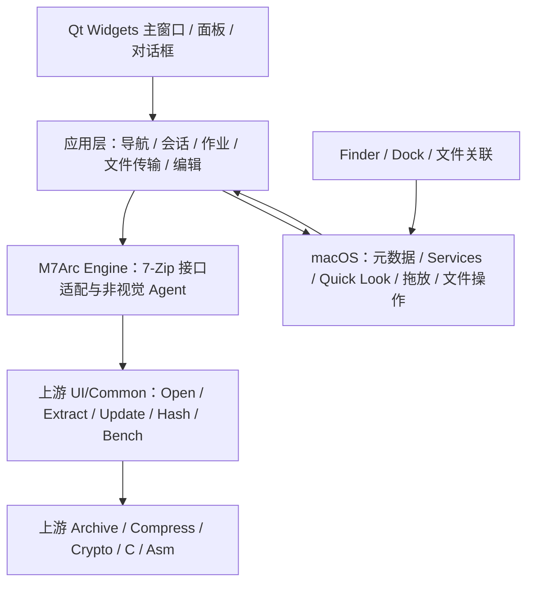

# M7Arc：macOS 7-Zip 文件管理器设计

设计基线：7-Zip 26.03 · 2026-09-06

M7Arc 是面向 macOS 的开源归档与文件管理工具：保留官方 7-Zip 的完整压缩、解压、格式解析和加密引擎，用 C++ 与 Qt Widgets 实现文件管理器，以 macOS API 完成文件元数据、Finder、Quick Look 和应用发行集成。

主窗口沿用 7-Zip File Manager 的六组菜单、七个工具栏动作、可编辑地址栏、属性列文件列表和状态栏。首次打开使用单面板详细信息视图，F9 切换双面板。产品终态包括完整归档操作、文件管理、包内编辑和嵌套归档回写、完整参数、哈希工具、基准测试及系统入口。各预览版本是通往这个终态的交付阶段。

## 设计文件

| 文件 | 内容 |
| --- | --- |
| [源码地图](docs/SOURCE_MAP.zh-CN.md) | 官方目录、构建目标、接口、格式与底层复用边界 |
| [功能迁移矩阵](docs/FEATURE_PARITY.zh-CN.md) | Windows 功能逐项对应 Qt/macOS 模块与交付阶段 |
| [界面规格](docs/UI_SPEC.zh-CN.md) | Qt 窗口组织、原型入口与整体交互 |
| [File Manager 规格](docs/FILE_MANAGER_SPEC.zh-CN.md) | 六菜单、七按钮、单/双面板、完整命令、属性列与键盘规则 |
| [对话框与任务规格](docs/DIALOG_SPEC.zh-CN.md) | 添加、提取、覆盖、密码、进度、设置、摘要与基准的完整字段 |
| [格式与编码能力](docs/FORMAT_CAPABILITIES.zh-CN.md) | 61 个 handler、七类创建、三个 TAR 组合及算法参数 |
| [实施路线](docs/ROADMAP.zh-CN.md) | P0–P6 工作包、依赖、验收场景与投入估计 |
| [交互原型](design/m7arc-ui.html) | File Manager 完整框架、菜单、格式中心、参数联动与工具窗口 |
| [引擎基线](docs/evidence/engine-baseline.json) | 本机官方引擎构建和有限样本验证结果 |
| [格式与方法目录](docs/evidence/7zz-info.txt) | 本次完整构建的 `7zz i` 输出 |

## 1. 产品名称与定位

工作名 **M7Arc**，读作 “M Seven Arc”。M 对应 Mac，7 对应 7-Zip，Arc 对应 archive。正式产品名称尚待确定；文档、目录和构建目标暂以 `M7Arc` / `m7arc` 表示。品牌描述使用 “7-Zip file manager for macOS”，About 中显示独立的应用版本与上游引擎版本。

图标方向是带有数字 7 折线的归档盒；系统工具栏使用统一线性图标，强调色只用于当前面板、主要动作和进度。品牌应建立自己的图形与字体组合，并清晰保留 7-Zip 归属说明。

| 候选 | 判断 |
| --- | --- |
| **M7Arc** | 首选，既含 Mac/7-Zip 元素，又适合作为独立品牌 |
| Z7M | 紧凑，图标表现容易，名称含义需要解释 |
| 7zMac | 含义直接，辨识度与独立品牌感较弱 |

已有相近产品包括 [mac7z](https://github.com/romainpelletant/mac7z)、[SevenMac](https://github.com/Seredyon/SevenMac) 和归档框架 [m7z](https://github.com/mplpl/m7z)。M7Arc 可以用“完整 File Manager 工作流、直接接入官方引擎、Mac 文件语义”建立明确定位。

## 2. 源码基础与已验证能力

`third_party/7zip/` 来自官方 [ip7z/7zip](https://github.com/ip7z/7zip)，版本 **26.03**，基线提交 `0766b733fe3e06dd2a7f9a3cfbf2108ac73abd17`。目录包含 1,294 个非 Git 文件；其中 `C/` 177 个、`CPP/7zip/Archive/` 224 个、`CPP/7zip/UI/` 386 个。

源码已经包含官方 macOS/POSIX 引擎、Apple CPU 特性检测和 arm64 汇编构建。完整入口是 `CPP/7zip/Bundles/Alone2`，生成 `7zz`。`Alone`、`Alone7z` 和单格式 `Format7z` 是不同程度的裁剪目标。

本次在本机 Apple Silicon 上使用上游 `cmpl_mac_arm64.mak` 构建成功，启用官方 ASM。以自行创建的小文件验证了下列行为：

| 项目 | 结果 |
| --- | --- |
| 7z、ZIP、TAR 创建 → 测试 → 解压 | 文件内容逐字节一致 |
| 中文名称、带空格名称、空目录 | 三种格式往返保留 |
| 普通脚本的可执行位 | 三种格式往返保留 |
| 7z 密码与文件名加密 | 创建、测试与提取成功 |
| 7z 128 字节分卷样本 | 3 个分卷，测试与提取成功 |
| 人工添加的 `com.apple.metadata:m7arc-probe` 扩展属性 | 三种格式默认往返均未保留 |

完整引擎注册 **61 个 handler（含 Hash）、25 个 codec、10 个 hasher**，支持写入 **7z、ZIP、TAR、GZip、BZip2、XZ、WIM** 七类归档、流或镜像。Hash 的摘要清单生成另计；RAR/RAR5、Zstandard、DMG、APFS、HFS 等保留上游读取能力。七类写入格式之外提供 `.tar.gz`、`.tar.bz2`、`.tar.xz` 三个组合预设，分别串联 TAR 与已有压缩流 handler。

WIM 新建仅使用 Store；压缩 WIM/ESD 的读取和当前镜像的可更新性分别判断。GZip、BZip2、XZ 原生创建只接受单个文件流，多文件或目录通过 TAR 组合完成。扩展别名、公开 codec 与容器内部解码器、Hash 可识别后缀与实际算法均分别建模，完整目录见[格式与编码能力](docs/FORMAT_CAPABILITIES.zh-CN.md)。

## 3. 技术选择

| 项目 | 选择 | 原因 |
| --- | --- | --- |
| 主语言 | 新代码 C++20；官方引擎保持自身编译要求 | 避免因 UI 改动大规模现代化上游代码 |
| UI | Qt 6.11 系列，初始锁定 6.11.2；Qt Widgets | 密集表格、Model/View、菜单、键盘和参数对话框适合此产品 |
| 必需 Qt 模块 | Core、Gui、Widgets；Test/Linguist 用于开发 | 控制安装体积与依赖范围 |
| 平台桥接 | 少量 Objective-C++ `.mm` | 调用 AppKit、Foundation、QuickLookUI、UTType |
| 构建 | CMake + Ninja | 同时组织 Qt、C/C++、汇编及应用资源 |
| 系统目标 | macOS 13+，arm64 与 x86_64 | 对应 Qt 6.11 文档中的支持范围 |
| 分发 | 签名、公证的 Universal 2 DMG | 符合完整桌面文件管理器的访问与分发需求 |
| 引擎接入 | 应用直接调用同包 C++ 引擎库 | 获得结构化条目、进度、密码/覆盖回调与会话 |
| 命令行 | 另行提供同版官方 `7zz` | 保留现有脚本及全部命令行能力 |
| 配置 | QSettings + Qt 翻译资源 | 保存视图、默认参数、工具路径、收藏与工作目录 |

Qt 是框架，C++ 是主语言；Qt Designer 的 `.ui` 可用于参数对话框。Qt Widgets 并非每个控件都对应一个原生 NSControl，产品通过系统菜单、字体、颜色、焦点、拖放和快捷键遵循 macOS 习惯。[Qt UI comparison](https://doc.qt.io/qt-6/topics-ui.html)、[Qt macOS issues](https://doc.qt.io/qt-6/macos-issues.html)

Qt 6.11 的平台要求包括 macOS 13+、Xcode 15/macOS 14 SDK 或更新；引擎和全部打包依赖统一设置部署目标。Qt 更新按正常版本升级验证，不把开源发行绑定到仅商业提供的 LTS 补丁。[Qt for macOS](https://doc.qt.io/qt-6/macos.html)、[Qt releases](https://doc.qt.io/qt-6/qt-releases.html)

## 4. 总体架构



上游内部目录和依赖顺序保留，Qt 应用按产品职责组织。Qt 的 `QModelIndex`、`QWidget`、`QString` 不进入编解码器；上游的 `HRESULT`、`PROPVARIANT`、`UString` 和引用计数对象留在引擎接口实现中。

### 4.1 引擎组成

`sevenzip_objects` 使用 CMake OBJECT target 编译 `Format7zF/Arc_gcc.mak` 对应的全量格式、算法、加密和公共对象。它直接组成 `m7arc_engine` 共享库，加入 `Alone2` 所需的非控制台 `UI/Common` 业务对象和适配后的非视觉 Agent。

采用 `LoadCodecs.cpp` 这一套注册宿主。`ArchiveExports.cpp` 中另有 `RegisterArc`，属于 `Format7zF` 的另一种导出模式，不进入此库。OBJECT target 使依靠静态构造函数注册的格式对象全部参与链接。

`EngineSources.cmake` 保存明确的源文件选择，和上游 make 对象分组一一对应；按架构选择官方汇编。每次升级上游，对该清单做源文件差异核对，随后比较实际格式/方法注册目录。禁止用整个源码目录的递归 glob 混入 Windows GUI、多个 main 或重复注册宿主。

arm64 与 x86_64 分别构建匹配的 Mach-O 产物后合并。arm64 使用官方 ARM64 汇编；Intel 初始使用官方 `var_mac_x64.mak` 的配置。共享库 install name 使用 `@rpath`，正式安装到 `.app/Contents/Frameworks`。

P5 保留原有外部 Codecs/Formats 扩展能力：在相关引擎对象中一致启用上游 `Z7_EXTERNAL_CODECS`，使用既有 `LoadDll/LoadDllsFromFolder` 和模块属性检查。内建格式继续完整编入，加载入口跳过单独的主 `7z.so`，从明确传入的 `.app/Contents/PlugIns/7zip` 和用户 `Application Support/M7Arc/7zip` 目录加载。外部 format 需要调用内建 codec 时，接通上游的 `EXPORT_CODECS` 导出内部方法目录和 `SetCodecs` 流程。

扩展在启动时加载，活动归档全部释放后才能卸载；安装/移除后重启应用。设置显示模块、方法和加载错误。Windows DLL 需要以当前官方接口重新构建为目标架构的 Mach-O 模块。

为支持用户自行安装的不同签名团队的原生 codec，P5 主应用使用 Apple 提供的 Disable Library Validation entitlement；其他 Hardened Runtime 与公证要求保持适用。Quick Look 扩展和自解压器只加载随产品打包的模块。随包模块按发行身份签名；用户模块只从明确的扩展目录加载。[Apple library validation](https://developer.apple.com/documentation/bundleresources/entitlements/com.apple.security.cs.disable-library-validation)

### 4.2 引擎提供的业务入口

| 接口职责 | 输入与结果 | 上游实现 |
| --- | --- | --- |
| 格式与方法目录 | 格式、扩展名、读写能力、方法与参数 | CCodecs、CArcInfoEx |
| 打开与目录快照 | 归档路径/流、选项 → 会话、条目、属性 | CArchiveLink、CAgent/CAgentFolder |
| 提取与测试 | 条目索引、目标、路径/覆盖选项 → 逐项结果 | Extract、IInArchive |
| 创建与更新 | 输入清单、格式参数、更新方式 → 新归档/新修订 | UpdateArchive、AgentOut |
| 删除/重命名/回写 | 会话、原条目、变更 → 新归档修订 | IFolderOperations、ArchiveFolderOut |
| 哈希、验证摘要、基准 | 路径/方法/测试配置 → 结构化结果 | HashCalc、Hash handler、Bench |

参数对象保持压缩级别、算法、字典、单词大小/模型阶数、固实块、线程、压缩/解压内存、分卷、密码、加密文件名、路径和更新规则。原添加窗口中的这些参数默认完整展示；方法序列、滤镜、元数据与时间细项通过原有“选项”入口展开。自定义参数通过结构化属性传递给上游 `ISetProperties`，参数栏与结构化字段共同形成最终有效配置。

7z 普通方法列表保留 LZMA2、LZMA、PPMd、BZip2，Deflate / Deflate64 在扩展方法中提供，Copy 由 0 级表示。ZIP 保留 Deflate、Deflate64、BZip2、LZMA、PPMd，0 级为 Store；TAR 的 GNU/POSIX 是头格式；WIM 仅有 Store。方法元数据由同一目录服务提供，创建窗口、格式中心和归档属性共用能力定义。

应用启动后由实际 `CCodecs` 目录生成格式能力表；每个已打开归档再生成实例能力。可写格式中的特殊只读实例、嵌套层限制、分卷和设备状态可以使删除/重命名不可用。

### 4.3 最少的应用模型

| 模型 | 必需状态 |
| --- | --- |
| `Location` | 本地文件 URL，或会话 + 当前归档目录；两者明确区分 |
| `ArchiveSession` | 打开的归档、当前修订号、父层、临时 backing、读写能力、密码会话 |
| `EntryRef` | 会话 ID、修订号、原始条目索引；路径用于显示 |
| `FolderSnapshot` | 可供 UI 读取的条目值与属性列；不持有借用的引擎内存 |
| `ArchiveOptions` | 有类型的压缩/提取/更新参数与高级属性集合 |
| `Job` | 动作、输入、阶段、总量是否已知、错误、取消与交互请求 |
| `EditSession` | 原 EntryRef、临时文件、外部工具、待保存状态 |

本地面板采用 `QFileSystemModel` 和独立文件操作控制器；归档面板采用 `QAbstractItemModel`。二者共用 `PanelView` 的导航、选择与命令呈现，并各自提供实际能力。

`EntryRef` 使用会话修订号区分重新打开后的索引失效。归档允许同路径条目存在；选择、编辑、删除始终绑定真实条目，不能只按文件名搜索第一个匹配项。

### 4.4 线程、任务与交互回调

初始实现使用一个专用引擎工作线程串行执行引擎操作；单次压缩保留上游内部多线程。多个打开面板展示最近目录快照，导航请求入队；本地目录读取和 macOS UI 保持响应。这样避免不同任务改变上游全局大小写/配置状态，也防止多个大字典任务同时争抢内存。

```text
Queued → Scanning → Running → Committing → Completed
                      ↕
                AwaitingUser / Paused

可中断阶段 → Cancelling → Cancelled
操作失败   → Failed（附逐项结果和可保留的输出）
```

引擎回调可以来自内部线程。进度只更新线程安全状态，再以 queued signal 发送给 UI；UI 定时合并刷新。密码、覆盖、内存询问带有作业 ID 和请求 ID，工作线程在条件变量上等待用户选择；关闭窗口或取消作业也必须解除等待。

暂停在回调安全点生效。归档最终提交阶段显示“正在完成写入”，完成当前替换后再响应退出，避免生成半个正式归档。进度保留阶段与分母含义；未知总量时显示不定进度，不把压缩输入量和解压输出量混为同一统计。

密码默认仅在相应会话中使用，不写入设置或任务日志。错误分为无法打开、密码问题、成员损坏、输出写入失败和部分成功，并保留上游详细信息。

### 4.5 File Manager 窗口与命令组织

主工作区由文件面板占满。每个面板具有上级按钮、路径历史下拉、可编辑地址栏、文件列表和四段状态栏。属性、格式目录、作业详情与设置各自打开窗口。单/双面板切换保存双方目录、选择、排序和列设置；Tab 切换当前面板，复制/移动的默认目标取另一面板路径。

| 界面结构 | 完整行为 | Qt 实现 |
| --- | --- | --- |
| 文件菜单 | 打开、内部打开及 `*` / `#` 模式、外部查看/编辑、重命名、复制/移动、删除、分割/合并、属性、注释、CRC/SHA、差异比较、新建目录/文件、链接、备用流 | 共享 `QAction` 与能力驱动 `QMenu` |
| 编辑菜单 | 全选、取消、反选、按掩码选择/取消、按类型选择/取消；保留键盘剪贴板操作 | `QItemSelectionModel`、选择命令 |
| 查看菜单 | 大/小图标、列表、详细信息；五种排序、平面视图、双面板、时间精度/UTC、工具栏设置、根/上级/历史、刷新/自动刷新 | 视图模型、排序代理、`QActionGroup` |
| 收藏夹菜单 | 0–9 十个槽位，保存与打开本地或归档内路径 | 导航控制器、`QSettings` |
| 工具菜单 | 六页选项、基准测试、临时文件管理；M7Arc 格式中心入口 | 独立工具对话框 |
| 帮助菜单 | 内容、关于、版本和许可证；Qt 正式应用按 macOS 菜单角色放置相应动作 | `QMenuBar`、`QAction::MenuRole` |
| 七个工具栏动作 | 添加 → 提取 → 测试 → 复制 → 移动 → 删除 → 信息；分组、大按钮和文字均可配置 | `QToolBar`，复用菜单动作 |
| 文件属性列 | 按 provider 枚举普通/原始属性，包括大小、压缩后大小、CRC、方法、加密、块、权限、时间、偏移、链接；保存列顺序、宽度和显隐 | `QTableView`、`QHeaderView` |
| 状态栏 | 选择/总对象数、操作对象总大小、焦点文件大小、焦点文件修改时间 | 面板底部四个状态区 |

“添加到压缩包”使用原版两列参数结构：左侧为格式、级别、方法、字典、单词大小/阶数、固实块、线程、内存、分卷和参数；右侧为更新模式、路径模式、操作选项、密码和加密。切换格式后直接更新控件选项与可用性。“提取”保留目标路径、同名目录、路径模式、消除重复根、五种覆盖策略及密码。普通参数的可见性不依赖用户先找到高级面板。

格式中心按归档/软件包、流、文件系统、磁盘/分区、可执行文件/固件、文档/媒体、分卷与摘要分类展示全部 61 个 handler，并提供扩展别名搜索、读取/写入筛选、codec 与 hasher 表。文件关联按扩展名聚合同一后缀的候选 handler；当前打开对象的工具栏状态由实例能力决定。

命令范围与快捷键详见 [File Manager 规格](docs/FILE_MANAGER_SPEC.zh-CN.md)，字段及任务状态详见 [对话框与任务规格](docs/DIALOG_SPEC.zh-CN.md)，方法及格式的具体边界详见 [格式与编码能力](docs/FORMAT_CAPABILITIES.zh-CN.md)。

## 5. 关键工作流

### 5.1 创建、更新与归档提交

扫描源文件后计算参数和资源需求，通过 `UpdateArchive` 或 Agent 更新入口写入目标卷上的临时归档。写入成功、输出流关闭后，以 macOS 文件替换操作提交，再重新打开得到新修订和目录快照。

提交前发生取消或写入失败时，已有原归档保持有效。跨卷工作目录只承担扫描/中间工作，最终替换用的文件必须先完整落到目标卷。分卷归档逐卷管理输出并在全部输出关闭后宣布作业成功；批量改名无法被描述为单个文件系统原子操作。

“压缩后删除源文件”只处理已成功加入且完成提交的输入项。跳过、失败、源文件在读取期间变化的条目保留原文件，并在结果中明确显示。

### 5.2 解压与目标冲突

沿用上游提取选项和路径处理，增加面向 macOS 文件系统的冲突呈现。目标支持保留完整路径、当前目录相对路径、平铺，以及同名归档子目录。

Windows/Linux 归档可能包含 macOS 默认大小写不敏感卷无法同时保存的名称；归档中也可能有 Unicode 规范化等价的名字。这些属于正常跨平台归档输入。浏览时保留所有真实条目，落盘时根据目标卷实际名称规则处理，允许重命名、跳过或更换目标；在会合到同一路径前显示冲突，不能静默覆盖。

路径越界、绝对路径和指向目标外的归档链接沿用上游保护，并验证 Qt 接入没有绕开现有提取流程。用户打开外来压缩包是这个产品的正常用法，相关文件写入边界直接属于解压功能。

### 5.3 四类文件传输

| 路由 | 实现顺序 |
| --- | --- |
| 本地 → 本地 | macOS 文件复制/移动，保留文件语义和元数据 |
| 本地 → 归档 | 收集选择项 → 更新目标归档 → 成功提交后处理移动源 |
| 归档 → 本地 | 提取选择项 → 得到逐项结果；移动还需成功删除归档源条目 |
| 归档 → 归档 | 选择项提取到临时目录 → 更新目标归档 → 移动时更新源归档 |

移动遵循“目标先成功，源后删除”。若删除源失败，结果显示“已复制，源尚未删除”。同一归档内部重命名/移动使用一次更新，避免走跨归档的提取路径。目标位于源目录内部等正常拖放误操作在执行前直接拒绝。

### 5.4 嵌套归档与外部编辑

嵌套路径表现为 `outer.zip ▸ inner.7z ▸ src/`，内部保存父子 `ArchiveSession`。只读浏览优先利用可 seek 的流；需要外部编辑或写入时使用受会话管理的临时文件。修改内层后逐层写回父归档，每层拥有自己的密码和能力。

离开有修改的归档层时，三个结果是：保存并返回、放弃并返回、取消并留在当前层。保存失败保留修改和临时文件，支持另存；原归档只在完整提交后更新。

外部编辑通过 `NSWorkspace` 或用户配置的命令启动，使用文件监视和“更新归档”动作管理完成。编辑器可能复用已经运行的进程，因此关闭进程不作为唯一完成条件。面板导航不改变 EditSession 的目标；会话修订变化时重新确认具体条目或另存。

临时文件按预览、编辑和更新作业分别持有。取消、预览结束和成功回写后按生命周期清理；尚未保存的编辑内容在退出时给出保存位置，不能随退出静默删除。

## 6. macOS 底层与系统集成

### 6.1 文件元数据

| 数据 | 设计处理 |
| --- | --- |
| 文件内容、POSIX mode、链接、mtime/atime | 保留上游能力，按具体格式选择保存方式 |
| birth time / 创建时间 | macOS 采集真实 birth time；支持的格式写入创建时间，恢复使用平台接口 |
| Finder 标签、FinderInfo、resource fork、一般 xattrs | 通过 `MacMetadata` 采集和恢复 |
| macOS ACL | 本地复制保留；归档模式随 AppleDouble 保存，在权限允许时恢复 |
| quarantine / 下载来源 | 依据 macOS 来源传播语义处理；区别于 Windows Zone.Identifier |
| Windows ADS/security | 保留可读取的归档属性与流，作为 Windows 元数据呈现 |

ZIP 的 Mac 模式采用 AppleDouble sidecar，与 `__MACOSX/.../._name` 组织方式对接。优先使用系统 `copyfile` 的 PACK/UNPACK 能力处理元数据编码，输入输出限定为当前作业中的关联成员。正常文件提取完成后恢复对应元数据，目录时间在子项完成后设置。[Apple copyfile](https://github.com/apple-oss-distributions/copyfile/blob/main/copyfile.3)

7z/TAR 的 Mac 保留模式也可以存放标准 AppleDouble sidecar，并由 M7Arc 识别恢复；这是一组归档成员约定，格式本身仍保持标准。原始视图始终能看到 sidecar。对于 `.tar.gz/.tar.bz2/.tar.xz`，元数据进入内层 TAR，再执行外层流压缩。

界面提供两个明确配置：“兼容分享”与“保留 Mac 元数据”。前者使用通用文件内容和格式已有属性；后者保存标签、资源叉等 Mac 信息。保存为 ZIP 时，Mac 用户间传递默认推荐后者。磁盘镜像中的 APFS/HFS 属性读取与普通目录压缩的元数据保存分开实现。

### 6.2 Finder、文件关联与预览

| 能力 | 平台实现 |
| --- | --- |
| 打开归档、Open With、Dock 拖放 | `CFBundleDocumentTypes` / UTType、应用文件打开事件 |
| Finder 中“打开 / 解压到 / 压缩为” | `NSServices` 服务接收所选文件 URL，转为应用命令 |
| Finder Quick Actions | 可安装的 Shortcuts/Automator 工作流调用应用入口 |
| Finder 中显示 | `NSWorkspace` reveal；支持本地归档和提取后的文件 |
| 空格预览归档成员 | 提取所选成员，交给 QuickLookUI，预览生命周期持有临时文件 |
| Finder 预览归档目录 | 独立 Quick Look Preview Extension，显示文件清单和归档属性 |
| 本地删除 | `NSFileManager`/Qt 平台能力移入废纸篓；永久删除为单独命令 |
| 归档成员拖到 Finder | `NSFilePromiseProvider`，目的地确定后提取承诺文件 |
| Finder 拖入归档 | 文件 URL 收集 → 目标归档更新作业 |
| 压缩后分享 | 完成归档后打开 macOS 分享面板或邮件草稿 |

Services 入口只接收数据和发起任务，避免在服务调用期间执行长时间压缩。[Apple Services](https://developer.apple.com/library/archive/documentation/Cocoa/Conceptual/SysServices/Articles/providing.html)

Finder Sync 用于同步目录及其状态，Apple 并未把它定义为任意位置的通用 Shell 菜单接口；主入口采用 Services 和文件关联。[Finder Sync](https://developer.apple.com/library/archive/documentation/General/Conceptual/ExtensibilityPG/Finder.html)

预览扩展使用自己的短生命周期引擎实例，处理取消和系统分配的时间/内存范围。加密文件头显示锁定状态并引导在主应用打开。[Quick Look UI](https://developer.apple.com/documentation/QuickLookUI)

### 6.3 SFX 与安装器

保留“生成供 Windows 使用的 SFX”这一输出目标，用可分发的 Windows stub 组装归档；上游 Unix console SFX 则作为终端自解压目标验证。

macOS 双击提取器采用 `M7Arc Extractor.app`。面向普通用户的分发包包含已签名且保持不变的提取器应用与旁边的 `Payload.7z`，可封装到一个 DMG；提取器读取同目录 payload，必要时由用户选择。需要把 payload 放入 `.app/Contents/Resources` 的发布者模式，在全部内容固定后对整包签名和公证。

安装器式解压后运行和配置脚本属于单独的发布者工作流，明确目标操作系统与命令；默认归档浏览和提取不会自动运行成员。macOS 用户生成的任意新 payload 不使用项目维护者的签名凭据。

## 7. 目录与构建目标

`M7Arc/` 是独立仓库根目录。官方源码以普通文件快照保存在 `third_party/7zip/`，随项目一起提交，保留全部上游目录、版权和许可证。版本信息记录在 `third_party/7zip.UPSTREAM.md`；下次升级按固定上游版本替换并核对本地适配。这个组织方式使源码、文档和构建在同一仓库内完整可用，代价是每次上游升级会在主仓库中呈现对应源码差异。

当前已有 README、设计文档、交互原型和完整上游快照。原型以 `design/m7arc-ui.html` 为独立入口，`design/prototype/` 保存命令、格式、对话框、窗口逻辑与样式。应用源码与构建模块按下列目标布局逐阶段加入：

```text
M7Arc/
├── CMakeLists.txt
├── CMakePresets.json
├── cmake/
│   ├── EngineSources.cmake       # 对应 Arc_gcc / Alone2 的显式源清单
│   ├── SevenZip.cmake           # 上游编译参数与架构选择
│   └── MacBundle.cmake          # app、库与扩展的安装规则
├── third_party/7zip/            # 官方源码快照，C/CPP/Asm/DOC 原样组织
├── third_party/7zip.UPSTREAM.md # 上游版本与更新记录
├── patches/7zip/                # 必需的平台修正，独立小补丁
├── src/
│   ├── engine/
│   │   ├── ArchiveEngine.h/.cpp
│   │   ├── EngineTypes.h
│   │   ├── SevenZipCallbacks.h/.cpp
│   │   ├── SevenZipStrings.h/.cpp
│   │   └── agent/              # 需要去平台依赖的上游 Agent 移植文件
│   ├── application/
│   │   ├── ArchiveSession.h/.cpp
│   │   ├── NavigationController.h/.cpp
│   │   ├── JobQueue.h/.cpp
│   │   ├── TransferController.h/.cpp
│   │   └── EditSession.h/.cpp
│   ├── models/
│   │   ├── ArchiveModel.h/.cpp
│   │   ├── JobModel.h/.cpp
│   │   └── PropertyModel.h/.cpp
│   ├── ui/
│   │   ├── MainWindow.h/.cpp
│   │   ├── CommandRegistry.h/.cpp
│   │   ├── PanelView.h/.cpp
│   │   ├── dialogs/            # Add / Extract / Properties / Progress / Hash / Bench / Options
│   │   └── widgets/            # AddressBar / ColumnSelector / PanelStatusBar
│   ├── platform/macos/
│   │   ├── MacFileOperations.mm
│   │   ├── MacMetadata.mm
│   │   ├── MacServices.mm
│   │   ├── MacFilePromises.mm
│   │   └── MacQuickLook.mm
│   └── main.cpp
├── extensions/quicklook/
├── extensions/codecs/            # 现有 7-Zip 模块接口的 Mac 构建示例
├── tools/extractor/
├── resources/                  # 图标、Qt 翻译、内置帮助
├── packaging/macos/             # Info.plist、entitlements、DMG 与发行脚本
├── tests/                      # 接口、归档互操作、GUI 与包验证
├── design/
│   ├── m7arc-ui.html           # 可直接打开的交互原型
│   └── prototype/             # commands / formats / dialogs / app / style
├── docs/
├── LICENSES/
└── README.md
```

源文件迁移有两种明确位置：未修改的文件直接从 `third_party/7zip` 编译；需要去除 UI/资源耦合的少量 Agent 文件放入 `src/engine/agent` 并保留原版权。`patches/7zip` 仅用于确实应落在上游文件里的平台修正，不能和移植副本同时编译同一实现。

| 构建目标 | 职责 |
| --- | --- |
| `sevenzip_objects` | 全格式算法对象及所需公共底层 |
| `m7arc_engine` | 共享引擎：对象、UI/Common、Agent 非视觉功能和 C++ 调用接口 |
| `m7arc` | Qt GUI、应用会话、任务与 macOS 桥接 |
| `7zz` | 官方完整命令行，与 GUI 使用同版格式源清单，按各自编译设置生成对象 |
| `m7arc_quicklook` | Finder 归档预览扩展，依发行规则提供引擎依赖 |
| `m7arc_extractor` | 独立自解压应用 |

## 8. 开源维护与发行

新增原创应用代码采用 MIT；迁移或复制的上游代码继续遵守原许可证。7-Zip 涉及 LGPL-2.1-or-later、BSD、公有领域声明和 unRAR 限制；不能把整个分发包描述成仅 MIT。Qt 使用实际选用模块的开源许可，动态链接并随发行提供许可证、对应源码获取及用户重建/替换库的说明。[本地 7-Zip 许可证](third_party/7zip/DOC/License.txt)、[Qt licensing](https://doc.qt.io/qt-6/licensing.html)、[Qt LGPL obligations](https://www.qt.io/development/open-source-lgpl-obligations)

当前发布顺序为：分架构构建 → 安装引擎、Qt、扩展、资源 → `macdeployqt` → 从内到外 ad-hoc 签名 → 重定位启动验证 → 制作 DMG → 安装验证。Apple Silicon 与 Intel 分别提供安装包，版本从根目录 VERSION 读取。取得 Developer ID 与公证凭据后，可增加完整签名、`notarytool` 公证及 stapler 票据；当前发布不依赖这些凭据。[Qt deployment](https://doc.qt.io/qt-6/macos-deployment.html)、[Apple notarization](https://developer.apple.com/documentation/security/notarizing-macos-software-before-distribution)

正式下载渠道为 GitHub Releases。验证通过的 DMG 作为版本附件发布，版本说明列出支持系统、架构、功能范围与已知问题。源码归档与可安装 DMG 分别提供；GitHub Actions 承担构建、依赖打包与发行流程，当前包明确标注没有 Developer ID 签名和 Apple 公证。[GitHub Releases](https://docs.github.com/en/repositories/releasing-projects-on-github/about-releases)

每个发布版本记录应用版本、上游提交与 Qt 版本。上游升级作为独立变更：更新源码快照和来源记录，审看 source manifest 和本地补丁差异，运行格式注册目录对比，再验证变更涉及的格式与工作流。英文作为可协作的源码与公开贡献语言，产品初期提供简体中文和英文，后续通过 Qt Linguist 扩展翻译。

首个开发切片是：`CMake 引擎库 → Qt 归档列表 → 选择成员提取 → 进度/密码/取消 → 可运行 .app`。同一实现继续扩展到功能迁移矩阵中的全部条目。

## 9. 已知问题与设计边界

1. **全功能以官方能力和可移植用户操作为准。** RAR 创建、Zstd 写入、DMG/APFS 卷创建不是当前默认 7-Zip 提供的能力。镜像浏览也不等于挂载、磁盘修复或读取正在使用的加密系统卷。
2. **Windows 平台对象需要语义替代。** 盘符、Explorer COM、NTFS ADS、ACL、junction、WSL 链接、大页权限和 FAR DLL 不能逐项变成同名 macOS 对象；功能矩阵规定其目标能力与保留方式。
3. **上游 File Manager 有真实流程缺口。** 包内向外移动未在对应 Agent 入口实现；嵌套包返回时的 Cancel 未完整传播；外部编辑绑定当前面板且存在同名成员定位问题。M7Arc 在应用会话层定义明确结果，详见功能矩阵。
4. **Mac 元数据尚需实现。** 本机有限样本确认默认 xattr 丢失；源码还使用 inode change time 作为 CTime，恢复路径忽略 creation time。AppleDouble 互操作、resource fork、ACL 与真实 birth time 必须在 P4 验收。其他解压器是否恢复 7z/TAR 中的 sidecar 取决于其实现。
5. **串行引擎操作是初始调度取舍。** 一个长作业期间，新归档打开/扫描可能等待；已有列表仍可浏览。提高任务并发前，需要消除涉及的全局状态并验证各实例线程模型。
6. **验证范围有限。** 本次环境为 macOS 27.0、Apple clang 21、arm64；未覆盖 macOS 13、Intel 真机、所有格式样本或 Qt 应用。官方 CLI 编译成功不等于 Qt 引擎库与最终产品已经完成。
7. **系统扩展与 SFX 受平台发行规则影响。** Services/Quick Actions 的显示与用户启用状态有关；内嵌新 payload 的 Mac 自解压 app 需要对完整产物重新签名，Windows SFX 只在目标 Windows 系统执行。
8. **名称仍为候选。** 有限公开检索未发现 M7Arc 的明确同类冲突，域名、组织名及商标可用性需在正式品牌发布时确认。
9. **外部模块有明确的 ABI 与发行条件。** 当前官方接口、编译宏和 CPU 架构必须匹配，旧 p7zip 与 Windows 模块不可直接加载。主应用为第三方原生扩展承担进程内插件的运行语义；预览扩展和自解压器使用随包模块集合。
