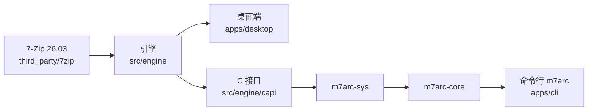

<h1 align="center">
  <picture>
    <source media="(prefers-color-scheme: dark)" srcset="resources/brand/wordmark-dark.svg">
    
  </picture>
</h1>

<p align="center">
  基于官方 7-Zip 26.03 完整引擎的 macOS 归档与文件管理器，附带命令行工具 <code>m7arc</code>。
</p>

<p align="center">
  <a href="https://github.com/hyyyyyyz/M7Arc/actions/workflows/macos.yml"></a>
  <a href="https://github.com/hyyyyyyz/M7Arc/releases"></a>
  <a href="#许可证"></a>
  
</p>

<p align="center">
  <a href="#安装">下载</a> ·
  <a href="#命令行-m7arc">命令行</a> ·
  <a href="#从源码构建">构建</a> ·
  <a href="#文档">文档</a>
</p>

## 概览

M7Arc 使用 C++20 和 Qt Widgets 编写，保留 7-Zip File Manager 的六组菜单、七按钮工具栏、地址栏和单/双面板，并采用 macOS 系统字体、轮廓图标、圆角控件与浅色/深色界面。它直接调用 7-Zip 完整引擎，所有格式和算法都来自官方源码。

- 系统要求：macOS 13 或更新版本，提供 Apple Silicon 和 Intel 两种安装包。
- 当前状态：预览版本 **0.1.0-alpha.2**，尚未完成全部发行验收，见[已知限制](#已知限制)。
- M7Arc 是工作名：M 代表 Mac，7 代表 7-Zip，Arc 来自 archive。正式产品名称尚待确定。

## 安装

1. 打开[官网](https://hyyyyyyz.github.io/M7Arc/)或 [GitHub Releases](https://github.com/hyyyyyyz/M7Arc/releases)，下载与你的处理器对应的 DMG（Apple Silicon 或 Intel）。
2. 打开 DMG，将 M7Arc 拖入“应用程序”，然后启动。Qt 和 7-Zip 运行依赖均包含在应用中。

当前发行使用 ad-hoc 签名，没有 Developer ID 签名和 Apple 公证。如果 macOS 阻止首次启动，可按 [Apple 的说明](https://support.apple.com/en-us/102445)，在“系统设置 → 隐私与安全性”中对已确认来源的应用选择“仍要打开”。

版本规则见[版本编号](docs/VERSIONING.zh-CN.md)，各版本变化见[更新日志](CHANGELOG.md)。

## 使用

### 桌面端

启动后默认是单面板详细信息视图，F9 切换双面板。在地址栏或文件列表中进入归档即可浏览；工具栏的添加、提取、测试、复制、移动、删除、信息按钮与 7-Zip File Manager 一致。窗口和参数的完整说明见[文件管理工作流](docs/FILE_MANAGER_SPEC.zh-CN.md)与[窗口和参数](docs/DIALOG_SPEC.zh-CN.md)。

### 命令行 m7arc

`m7arc` 在终端和 shell 脚本中创建、列出、提取、测试、编辑归档并计算校验。结果写到 stdout，进度和诊断写到 stderr；`--json` 输出单行 JSON；退出码固定（0 成功，1 操作失败，2 用法错误，3 需要密码或密码错误，130 被取消）。

```sh
m7arc create Docs.7z Docs -l 9 --exclude '*.tmp'   # 由文件名推断格式，-l 为压缩级别 0–9
m7arc list Docs.7z                                  # 列出成员；加 --json 得到机器可读结果
m7arc test Docs.7z                                  # 全部成员完好时退出码为 0
m7arc extract Docs.7z -o restored                   # 提取到 restored/
m7arc hash Docs/a.txt                               # <sha256>  Docs/a.txt
```

加密归档用环境变量或文件传入密码，避免出现在进程列表里：

```sh
export ARCHIVE_PW='...'
m7arc create -q secret.7z Docs --password-env ARCHIVE_PW --encrypt-names
m7arc list secret.7z </dev/null     # 没有终端且未提供密码：退出码 3，不会卡住等待输入
```

在脚本里读取 JSON：

```sh
m7arc list --json Docs.7z | python3 -c 'import json, sys; print(json.load(sys.stdin)["totals"])'
```

**位置与 PATH。** 命令行随应用安装，位于应用包内。已发布的 0.1.0-alpha.2 安装包尚不包含它，在下一个版本发布前请[从源码构建](#从源码构建)：

```text
/Applications/M7Arc.app/Contents/Helpers/m7arc
```

把它所在的目录加入 `PATH`（写进 `~/.zshrc` 可长期生效）：

```sh
export PATH="/Applications/M7Arc.app/Contents/Helpers:$PATH"
```

或者建一个符号链接，再确保 `~/.local/bin` 在 `PATH` 中：

```sh
mkdir -p ~/.local/bin
ln -s /Applications/M7Arc.app/Contents/Helpers/m7arc ~/.local/bin/m7arc
```

应用包另附官方 `7zz`。完整的命令、选项、密码来源、退出码和脚本示例见[命令行说明](apps/cli/README.md)，`m7arc --help` 与 `m7arc <命令> --help` 提供同样的参考。

## 功能

**格式与压缩**

- 完整内建目录：61 个 handler、25 个 codec、10 个 hasher；RAR/RAR5、磁盘镜像、文件系统和文档容器保留读取入口。
- 创建和更新 7z、ZIP、gzip、bzip2、xz、TAR、WIM，以及 tar.gz、tar.bz2、tar.xz。
- 密码、文件名加密、分卷、方法属性和固实块。
- 包含/排除规则，以及路径和时间选项。
- 原生外部 Codecs/Formats 模块，包含实际加载状态、错误报告和可构建的模块示例。

**文件管理**

- 双面板和四类文件传输、四种列表视图、动态属性列、收藏和选择掩码。
- 归档浏览、选择提取、完整性测试、覆盖处理、密码重试、进度、暂停和取消。
- 删除、重命名、ZIP 成员注释和归档内新建目录，按实际格式能力启用。
- 外部查看、编辑和 Diff，以及嵌套归档的逐层回写。

**macOS 集成**

- 扩展属性、资源叉、Finder 标签、ACL 和创建时间的保存与恢复。
- 本地文件操作、链接、废纸篓、挂载卷、Finder 文件拖出及复制粘贴。
- Services、可安装的 Quick Actions、归档文件关联和 Quick Look 预览扩展。
- 简体中文和英文界面，浅色/深色外观。

**命令行与自动化**

- `m7arc` 提供创建、列出、提取、测试、编辑、校验和格式查询。
- `--json` 输出与固定的退出码，便于脚本调用。
- 同一份 7-Zip 代码经引擎的 C 接口使用，与桌面端结果一致。

**工具**

- 多算法摘要、摘要清单、性能测试、文件分割/合并。
- macOS 终端、macOS 图形、Windows 普通自解压和 Windows 安装器分发。
- 包含搜索和快捷键说明的离线帮助。

## 从源码构建

完整源码保存在此项目内，构建不依赖旁边的上游 checkout。需要 macOS 开发工具、CMake、Ninja、Python 和 Qt 6.11.2；构建并打包 `m7arc` 还需要 Rust（cargo），没有 cargo 时配置会给出提示并跳过它。

```sh
cmake --preset release
cmake --build --preset release --parallel 4
ctest --preset release
open build/release/M7Arc.app
```

只构建命令行时不需要 Qt：在仓库根目录运行 `cargo build --release`，得到 `build/cargo/release/m7arc`。Qt 安装、架构选择和打包命令见[构建指南](docs/BUILDING.md)。

## 项目结构

7-Zip 官方源码经 `cmake/` 中的显式清单编译为共享引擎，引擎对外提供 C++ 适配层和 C 接口。Qt 桌面端直接调用 C++ 层；Rust 的 `m7arc-sys` 绑定 C 接口，`m7arc-core` 在其上提供安全 API，命令行 `m7arc` 再基于 `m7arc-core`。



| 目录 | 内容 |
| --- | --- |
| `src/engine/` | 7-Zip 适配、格式目录与回调；`capi/` 是 C 接口 |
| `src/platform/` | `MacMetadata`：元数据采集与恢复 |
| `crates/` | `m7arc-sys`（C 接口绑定）、`m7arc-core`（安全 Rust API） |
| `apps/cli/` | `m7arc` 命令行（Rust） |
| `apps/desktop/` | Qt 桌面端：`src/` 源码、`resources/` 资源、`tests/` 集成验证 |
| `cmake/` | 引擎源清单与构建目标 |
| `tests/engine/` | 引擎与 C 接口测试 |
| `packaging/macos/` | 部署、ad-hoc 签名、DMG、Release |
| `third_party/` | `7zip/` 官方完整源码，`patches/` 本地补丁 |
| `docs/`、`design/`、`website/` | 设计与发行文档、离线交互原型、GitHub Pages 官网 |

## 文档

| 想了解 | 看 |
| --- | --- |
| 命令行的全部命令、选项、退出码和脚本示例 | [apps/cli/README.md](apps/cli/README.md) |
| 构建环境、Qt 安装、架构与打包 | [docs/BUILDING.md](docs/BUILDING.md) |
| 整体设计与产品范围 | [DESIGN.zh-CN.md](DESIGN.zh-CN.md) |
| 功能与原版 7-Zip 的对应关系 | [功能迁移矩阵](docs/FEATURE_PARITY.zh-CN.md) |
| 各格式与方法的读写能力 | [格式能力](docs/FORMAT_CAPABILITIES.zh-CN.md) |
| 窗口字段与文件管理工作流 | [窗口和参数](docs/DIALOG_SPEC.zh-CN.md)、[文件管理工作流](docs/FILE_MANAGER_SPEC.zh-CN.md)、[界面与交互](docs/UI_SPEC.zh-CN.md) |
| macOS 系统入口与元数据互操作 | [系统入口](docs/MACOS_INTEGRATION.zh-CN.md)、[元数据互操作](docs/METADATA_INTEROP.zh-CN.md) |
| 外部 Codecs/Formats 模块 | [原生模块](docs/EXTERNAL_MODULES.zh-CN.md) |
| 随包的官方 `7zz` 与自解压 | [官方命令行与自解压包](docs/CLI_SFX.zh-CN.md) |
| 上游源码关系与本地补丁 | [源码地图](docs/SOURCE_MAP.zh-CN.md)、[上游补丁](docs/UPSTREAM_PATCHES.zh-CN.md) |
| 阶段范围与实施路线 | [路线图](docs/ROADMAP.zh-CN.md) |
| 测试清单与发行验证结果 | [验证记录](docs/VALIDATION.zh-CN.md)、[十万成员 ZIP](docs/LARGE_ARCHIVES.zh-CN.md) |
| 版本规则、发布流程 | [版本编号](docs/VERSIONING.zh-CN.md)、[发行指南](docs/RELEASE.zh-CN.md) |
| 标志、字标和配色 | [品牌与图标](docs/BRAND.zh-CN.md) |
| Qt 体积与替换评估 | [桌面端工具包评估](docs/TOOLKIT_EVALUATION.zh-CN.md) |
| 界面设计原型 | [design/index.html](design/index.html)，可离线打开；示例文件和性能数据仅用于演示 |

## 已知限制

- 预览版本尚未完成 macOS 13、Intel 真机和全部归档样本的发行验收。Apple Silicon 上通过 Rosetta 执行 Intel 测试不能替代 Intel 真机验证；Windows SFX 的载荷与结构验证也不能替代 Windows 实际运行。具体环境和结果见[发行验证记录](docs/VALIDATION.zh-CN.md)。
- 内建引擎支持 RAR/RAR5 解压，不支持 RAR 创建；Zstandard 为解码能力；WIM 创建使用 Store。
- 镜像浏览不提供磁盘挂载、修复或镜像写入。
- 硬链接记录仅在支持它的 TAR/WIM 容器中保存。
- 一个文件管理窗口同时运行一个引擎作业。
- 系统扩展的显示与 macOS 注册和用户启用状态有关。
- 其他解压器是否恢复 7z/TAR 中的 AppleDouble 元数据取决于其实现。

## 路线图

阶段范围、当前实现和发行验收状态见[路线图](docs/ROADMAP.zh-CN.md)。进入 1.0 前，将完成最低支持系统、Intel 真机、Windows SFX 实际运行及更完整的跨系统归档样本验收。

## 参与贡献

开发约定、提交与检查要求见[贡献指南](CONTRIBUTING.md)。构建说明见[构建指南](docs/BUILDING.md)，Git 标签、GitHub Actions 与 Release 附件流程见[发行指南](docs/RELEASE.zh-CN.md)。

## 许可证

原创应用代码采用 [MIT](LICENSE)。7-Zip 原有部分继续遵循 [LGPL、BSD、公有领域声明与 unRAR 条款](third_party/7zip/DOC/License.txt)，迁移的上游代码保留原声明。Qt 采用动态链接，发行包包含对应模块的许可、源码获取方式与库替换说明。不能将整个安装包描述为仅使用 MIT 许可证。

## 致谢

M7Arc 建立在 Igor Pavlov 的 [7-Zip](https://www.7-zip.org/) 之上，引擎、格式处理器和压缩算法来自该项目，文件管理器的菜单与工具栏沿用 7-Zip File Manager。桌面界面使用 [Qt](https://www.qt.io/)。
