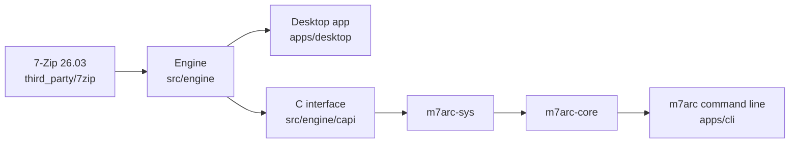

<h1 align="center">
  <picture>
    <source media="(prefers-color-scheme: dark)" srcset="resources/brand/wordmark-dark.svg">
    
  </picture>
</h1>

<p align="center">
  English · <a href="README.zh-CN.md">简体中文</a>
</p>

<p align="center">
  An archiver and file manager for macOS built on the complete official 7-Zip 26.03 engine, with the <code>m7arc</code> command-line tool.
</p>

<p align="center">
  <a href="https://github.com/hyyyyyyz/M7Arc/actions/workflows/macos.yml"></a>
  <a href="https://github.com/hyyyyyyz/M7Arc/releases"></a>
  <a href="#license"></a>
  
</p>

<p align="center">
  <a href="#install">Download</a> ·
  <a href="#command-line-m7arc">Command line</a> ·
  <a href="#build-from-source">Build</a> ·
  <a href="#documentation">Documentation</a>
</p>

## Overview

M7Arc is written in C++20 and Qt Widgets. It keeps the 7-Zip File Manager's six menu groups, seven-button toolbar, address bar and single or dual panels, and uses the macOS system font, outline icons, rounded controls and light and dark appearances. It calls the complete 7-Zip engine directly, and every format and algorithm comes from the official source.

- System requirements: macOS 13 or later, with installers for Apple Silicon and Intel.
- Status: preview release **0.1.0-alpha.2**. Release acceptance is not complete; see [Known limitations](#known-limitations).
- M7Arc is a working name: M stands for Mac, 7 for 7-Zip, and Arc comes from archive. The final product name is not yet decided.

## Install

1. Open the [website](https://hyyyyyyz.github.io/M7Arc/) or [GitHub Releases](https://github.com/hyyyyyyz/M7Arc/releases) and download the DMG that matches your processor (Apple Silicon or Intel).
2. Open the DMG, drag M7Arc to Applications, and launch it. Qt and the 7-Zip runtime dependencies are included in the app.

The current release uses an ad-hoc signature, with no Developer ID signature and no Apple notarization. If macOS blocks the first launch, follow [Apple's instructions](https://support.apple.com/en-us/102445) and choose Open Anyway in System Settings → Privacy & Security for the app you have confirmed.

For the versioning rules, see [Versioning](docs/VERSIONING.zh-CN.md) (Chinese). For the changes in each release, see the [changelog](CHANGELOG.md).

## Usage

### Desktop app

M7Arc opens in a single-panel Details view; press F9 to switch to two panels. Browse an archive by opening it from the address bar or the file list. The toolbar buttons Add, Extract, Test, Copy, Move, Delete and Info match those of 7-Zip File Manager. For a full description of the windows and parameters, see [File manager workflows](docs/FILE_MANAGER_SPEC.zh-CN.md) (Chinese) and [Dialogs and parameters](docs/DIALOG_SPEC.zh-CN.md) (Chinese).

### Command line: m7arc

`m7arc` creates, lists, extracts, tests and edits archives and computes checksums, in the terminal and in shell scripts. Results go to stdout, and progress and diagnostics go to stderr. `--json` prints a single line of JSON. Exit codes are fixed: 0 for success, 1 for a failed operation, 2 for a usage error, 3 when a password is required or wrong, and 130 when cancelled.

```sh
m7arc create Docs.7z Docs -l 9 --exclude '*.tmp'   # format inferred from the file name; -l is the compression level 0–9
m7arc list Docs.7z                                  # list members; add --json for machine-readable output
m7arc test Docs.7z                                  # exit code 0 when every member is intact
m7arc extract Docs.7z -o restored                   # extract into restored/
m7arc hash Docs/a.txt                               # <sha256>  Docs/a.txt
```

Pass the password of an encrypted archive through an environment variable or a file, so that it does not appear in the process list:

```sh
export ARCHIVE_PW='...'
m7arc create -q secret.7z Docs --password-env ARCHIVE_PW --encrypt-names
m7arc list secret.7z </dev/null     # no terminal and no password: exit code 3, without waiting for input
```

Read the JSON output in a script:

```sh
m7arc list --json Docs.7z | python3 -c 'import json, sys; print(json.load(sys.stdin)["totals"])'
```

**Location and PATH.** The command line is installed with the app, inside the app bundle. The published 0.1.0-alpha.2 package does not include it yet; until the next release, [build it from source](#build-from-source):

```text
/Applications/M7Arc.app/Contents/Helpers/m7arc
```

Add the directory that contains it to `PATH` (put the line in `~/.zshrc` to keep it across sessions):

```sh
export PATH="/Applications/M7Arc.app/Contents/Helpers:$PATH"
```

Or create a symbolic link and make sure `~/.local/bin` is on `PATH`:

```sh
mkdir -p ~/.local/bin
ln -s /Applications/M7Arc.app/Contents/Helpers/m7arc ~/.local/bin/m7arc
```

The app bundle also includes the official `7zz`. For the complete commands, options, password sources, exit codes and script examples, see the [command-line reference](apps/cli/README.md); `m7arc --help` and `m7arc <command> --help` print the same reference.

## Features

**Formats and compression**

- Complete built-in catalog: 61 handlers, 25 codecs and 10 hashers. RAR/RAR5, disk images, file systems and document containers can be opened for reading.
- Create and update 7z, ZIP, gzip, bzip2, xz, TAR and WIM, as well as tar.gz, tar.bz2 and tar.xz.
- Passwords, file name encryption, volumes, method properties and solid blocks.
- Include and exclude rules, and path and time options.
- Native external Codecs/Formats modules, with the actual load status, error reporting and a module example you can build.

**File management**

- Two panels, four kinds of file transfer, four list views, dynamic property columns, Favorites and selection masks.
- Archive browsing, selective extraction, integrity testing, overwrite handling, password retry, progress, pause and cancel.
- Delete, rename, ZIP member comments and new folders inside archives, enabled according to what each format supports.
- External view, edit and Diff, and write-back of nested archives one level at a time.

**macOS integration**

- Saving and restoring of extended attributes, resource forks, Finder tags, ACLs and creation time.
- Local file operations, links, Trash, mounted volumes, dragging files out to Finder, and copy and paste.
- Services, installable Quick Actions, archive file associations and a Quick Look preview extension.
- Simplified Chinese and English interface, in light and dark appearance.

**Command line and automation**

- `m7arc` creates, lists, extracts, tests, edits and hashes archives, and queries formats.
- `--json` output and fixed exit codes make it easy to call from scripts.
- It uses the same 7-Zip code through the engine's C interface, so its results match the desktop app.

**Tools**

- Multi-algorithm hashes, hash manifests, a benchmark, and file split and combine.
- Self-extracting archives as a macOS terminal extractor, a macOS graphical extractor, a plain Windows self-extractor and a Windows installer.
- Offline help with search and a keyboard shortcut reference.

## Build from source

The complete source is kept in this project, so the build does not depend on an upstream checkout next to it. You need the macOS developer tools, CMake, Ninja, Python and Qt 6.11.2. Building and packaging `m7arc` also needs Rust (cargo); without cargo, configuration prints a warning and skips it.

```sh
cmake --preset release
cmake --build --preset release --parallel 4
ctest --preset release
open build/release/M7Arc.app
```

Building only the command line does not need Qt: run `cargo build --release` in the repository root to get `build/cargo/release/m7arc`. For Qt installation, architecture selection and packaging commands, see the [build guide](docs/BUILDING.md).

## Project structure

The official 7-Zip sources are compiled from explicit lists in `cmake/` into a shared engine, which exposes a C++ adapter layer and a C interface. The Qt desktop app calls the C++ layer directly. The Rust crate `m7arc-sys` binds the C interface, `m7arc-core` provides a safe API on top of it, and the `m7arc` command line is built on `m7arc-core`.



| Directory | Contents |
| --- | --- |
| `src/engine/` | 7-Zip adapters, format catalog and callbacks; `capi/` is the C interface |
| `src/platform/` | `MacMetadata`: metadata capture and restore |
| `crates/` | `m7arc-sys` (C interface bindings), `m7arc-core` (safe Rust API) |
| `apps/cli/` | The `m7arc` command line (Rust) |
| `apps/desktop/` | Qt desktop app: `src/` sources, `resources/` resources, `tests/` integration checks |
| `cmake/` | Engine source lists and build targets |
| `tests/engine/` | Engine and C interface tests |
| `packaging/macos/` | Deployment, ad-hoc signing, DMG, release |
| `third_party/` | `7zip/` the complete official source, `patches/` local patches |
| `docs/`, `design/`, `website/` | Design and release documents, offline interaction prototype, GitHub Pages website |

## Documentation

| Topic | Document | Language |
| --- | --- | --- |
| All commands, options, exit codes and script examples for the command line | [apps/cli/README.md](apps/cli/README.md) | English |
| Build environment, Qt installation, architectures and packaging | [docs/BUILDING.md](docs/BUILDING.md) | English |
| Overall design and product scope | [DESIGN.zh-CN.md](DESIGN.zh-CN.md) | Chinese |
| How features map to the original 7-Zip | [Feature parity matrix](docs/FEATURE_PARITY.zh-CN.md) | Chinese |
| Read and write capabilities of each format and method | [Format capabilities](docs/FORMAT_CAPABILITIES.zh-CN.md) | Chinese |
| Window fields and file manager workflows | [Dialogs and parameters](docs/DIALOG_SPEC.zh-CN.md), [File manager workflows](docs/FILE_MANAGER_SPEC.zh-CN.md), [Interface and interaction](docs/UI_SPEC.zh-CN.md) | Chinese |
| macOS system entry points and metadata interoperability | [System entry points](docs/MACOS_INTEGRATION.zh-CN.md), [Metadata interoperability](docs/METADATA_INTEROP.zh-CN.md) | Chinese |
| External Codecs/Formats modules | [Native modules](docs/EXTERNAL_MODULES.zh-CN.md) | Chinese |
| The bundled official `7zz` and self-extracting archives | [Official command line and self-extracting archives](docs/CLI_SFX.zh-CN.md) | Chinese |
| Relationship to the upstream source and local patches | [Source map](docs/SOURCE_MAP.zh-CN.md), [Upstream patches](docs/UPSTREAM_PATCHES.zh-CN.md) | Chinese |
| Stage scope and implementation plan | [Roadmap](docs/ROADMAP.zh-CN.md) | Chinese |
| Test checklist and release validation results | [Validation record](docs/VALIDATION.zh-CN.md), [ZIP with 100,000 members](docs/LARGE_ARCHIVES.zh-CN.md) | Chinese |
| Versioning rules and release process | [Versioning](docs/VERSIONING.zh-CN.md), [Release guide](docs/RELEASE.zh-CN.md) | Chinese |
| Logo, wordmark and colors | [Brand and icons](docs/BRAND.zh-CN.md) | Chinese |
| Qt size and replacement evaluation | [Desktop toolkit evaluation](docs/TOOLKIT_EVALUATION.zh-CN.md) | Chinese |
| Interface design prototype | [design/index.html](design/index.html), which opens offline; sample files and performance figures are for demonstration only | Chinese |

## Known limitations

- The preview has not completed release acceptance on macOS 13, real Intel hardware and the full set of archive samples. Running Intel tests under Rosetta on Apple Silicon does not replace verification on real Intel hardware, and payload and structure checks of Windows self-extracting archives do not replace running them on Windows. For the environments and results, see the [release validation record](docs/VALIDATION.zh-CN.md) (Chinese).
- The built-in engine extracts RAR/RAR5 but does not create RAR; Zstandard is decode-only; WIM creation uses Store.
- Image browsing does not provide disk mounting, repair or image writing.
- Hard link records are stored only in TAR and WIM containers that support them.
- A file manager window runs one engine job at a time.
- Whether system extensions appear depends on their macOS registration and on whether the user has enabled them.
- Whether other extractors restore AppleDouble metadata from 7z and TAR archives depends on their implementation.

## Roadmap

The [roadmap](docs/ROADMAP.zh-CN.md) (Chinese) covers the scope of each stage, the current implementation and the release acceptance status. Before 1.0, the project will complete acceptance on the minimum supported system and on real Intel hardware, run the Windows self-extractors on Windows, and cover a broader set of cross-system archive samples.

## Contributing

For development conventions and commit and check requirements, see the [contributing guide](CONTRIBUTING.md). Build instructions are in the [build guide](docs/BUILDING.md); the process for Git tags, GitHub Actions and release assets is in the [release guide](docs/RELEASE.zh-CN.md) (Chinese).

## License

Original application code is licensed under [MIT](LICENSE). The original 7-Zip parts remain under [LGPL, BSD, public-domain notices and the unRAR terms](third_party/7zip/DOC/License.txt), and migrated upstream code keeps its original notices. Qt is dynamically linked; the distribution package includes the licenses of the corresponding modules, instructions for obtaining their source, and instructions for replacing the libraries. The installation package as a whole is not covered by the MIT license alone.

## Acknowledgments

M7Arc is built on Igor Pavlov's [7-Zip](https://www.7-zip.org/). The engine, format handlers and compression algorithms come from that project, and the file manager's menus and toolbar follow 7-Zip File Manager. The desktop interface uses [Qt](https://www.qt.io/).
